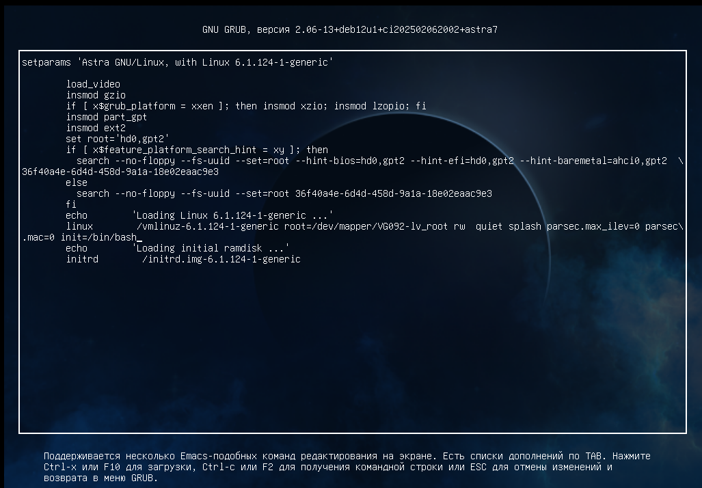
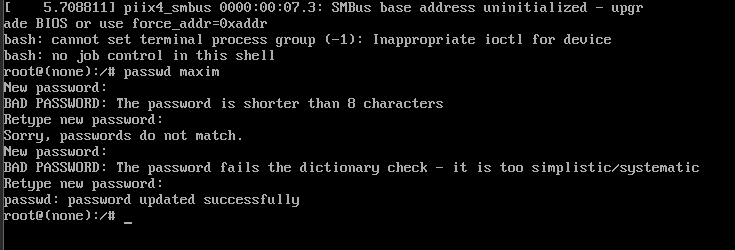
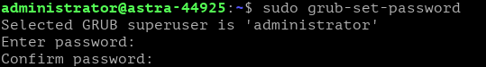
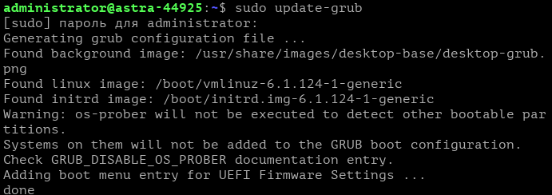
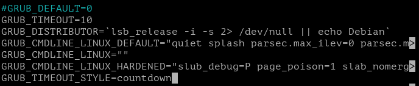
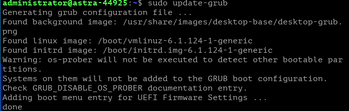
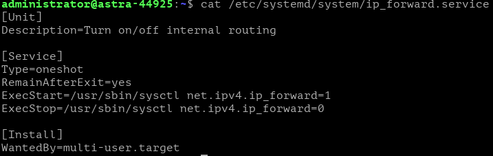
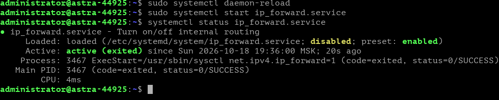
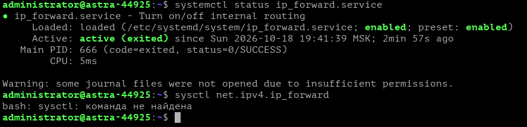

# Лабораторная работа: Процесс загрузки и выключения системы


> **Дисциплина:** Операционные системы и среды (группа 0709-25-1)  
> **Тема:** Процесс загрузки и выключения системы в ОС Astra Linux  
> **Цель работы:** Приобретение практических навыков работы с загрузчиком GRUB и системой инициализации systemd: управление параметрами загрузки ядра, сброс/смена паролей пользователей и GRUB, настройка таймаутов загрузки, создание и администрирование пользовательских systemd-юнитов.

---

## 📋 Содержание и ход выполнения работы

### Раздел 1. Настройка параметров, смена паролей и проверка корректности смены

---

#### 1.1. Настройка параметров загрузки через GRUB (Рисунок 1)
* **Задание:** Во время загрузки системы войти в редактор пунктов меню GRUB (клавиша `e`), изменить режим монтирования корневого раздела на чтение/запись (`rw`) и передать ядру параметр `init=/bin/bash` для запуска командной оболочки с PID=1 в обход стандартного процесса инициализации.
* **Выполненные действия:** 
  - В строке параметров ядра `linux /vmlinuz-6.1.124-1-generic root=/dev/mapper/VG092-lv_root` изменён флаг на `rw`.
  - Добавлен параметр `init=/bin/bash`.
* **Файл:** `1_Задание_1_Настройка_параметров_загрузки_GRUB.png`  
  *(исходный файл: `Снимок экрана 2026-10-18 185357.png`)*

<p align="center">
  
</p>

---

#### 1.2. Смена пароля пользователя через single-user bash (Рисунок 2)
* **Задание:** После загрузки ядра с параметром `init=/bin/bash` в однопользовательском режиме с правами `root` сменить пароль пользователя системы с помощью утилиты `passwd`.
* **Выполненные действия:**
  - Запущена команда `passwd maxim`.
  - Продемонстрирована работа встроенных механизмов безопасности парольной политики PAM в Astra Linux (проверка минимальной длины в 8 символов, проверка совпадения паролей, словарная проверка на сложность).
  - Успешно установлен новый пароль (`passwd: password updated successfully`).
* **Файл:** `1_Задание_2_Смена_пароля_пользователя_passwd.png`  
  *(исходный файл: `Снимок экрана 2026-10-18 185554.png`)*

<p align="center">
  
</p>

---

#### 1.3. Смена пароля GRUB и пересборка конфигурации (Рисунок 3)
* **Задание:** Установить пароль суперпользователя загрузчика GRUB для защиты параметров загрузки от несанкционированного изменения (`grub-set-password`) и пересобрать файл конфигурации (`update-grub`).
* **Выполненные действия:**
  1. Выполнена команда `sudo grub-set-password`, назначен суперпользователь `administrator`, введён и подтверждён пароль.
  2. Выполнена команда `sudo update-grub` для генерации конфигурационного файла `/boot/grub/grub.cfg` с обновлёнными хэшами доступа.
* **Файлы:**
  - `1_Задание_4_Смена_пароля_GRUB_grub-set-password.png` *(исходный файл: `Снимок экрана 2026-10-18 190141.png`)*
  - `1_Задание_4_Обновление_конфигурации_update-grub.png` *(исходный файл: `Снимок экрана 2026-10-18 185953.png`)*

<p align="center">
  
</p>
<p align="center">
  
</p>

---

#### 1.4. Настройка GRUB-таймаута с обратным отсчетом (Рисунки 4, 5, 6)
* **Задание:** Настроить время ожидания GRUB перед автозагрузкой на 10 секунд с отображением текстового обратного отсчета без вывода интерактивного меню выбора.
* **Выполненные действия:**
  1. В файле `/etc/default/grub` установлены параметры:
     ```ini
     #GRUB_DEFAULT=0
     GRUB_TIMEOUT=10
     GRUB_TIMEOUT_STYLE=countdown
     ```
  2. Изменения применены командой `sudo update-grub`.
  3. Выполнена перезагрузка системы; зафиксировано корректное отображение счётчика обратного отсчёта секунд в левом верхнем углу (кадры 7 сек и 3 сек).
* **Файлы:**
  - `1_Задание_6_Настройка_таймаута_в_etc_default_grub.png` *(исходный: `Снимок экрана 2026-10-18 190654.png`)* — Рисунок 4
  - `1_Задание_6_Применение_таймаута_update-grub.png` *(исходный: `Снимок экрана 2026-10-18 190800.png`)* — Рисунок 5
  - `1_Задание_6_Счетчик_загрузки_GRUB_7сек.png` *(исходный: `Снимок экрана 2026-10-18 190855.png`)* — Рисунок 6 (а)
  - `1_Задание_6_Счетчик_загрузки_GRUB_3сек.png` *(исходный: `Снимок экрана 2026-10-18 190901.png`)* — Рисунок 6 (б)

<p align="center">
  
</p>
<p align="center">
  
</p>
<p align="center">
  
  &nbsp;&nbsp;&nbsp;&nbsp;
  
</p>

---

### Раздел 2. Создание и тестирование systemd-юнита

---

#### 2.1. Создание и настройка службы ip_forward.service (Рисунки 7–8)
* **Задание:** Создать юнит типа service с именем `ip_forward.service` для управления пересылкой пакетов (маршрутизацией на уровне ядра IPv4 через параметр `net.ipv4.ip_forward`).
* **Конфигурация юнита `/etc/systemd/system/ip_forward.service`:**
  ```ini
  [Unit]
  Description=Turn on/off internal routing

  [Service]
  Type=oneshot
  RemainAfterExit=yes
  ExecStart=/usr/sbin/sysctl net.ipv4.ip_forward=1
  ExecStop=/usr/sbin/sysctl net.ipv4.ip_forward=0

  [Install]
  WantedBy=multi-user.target
  ```
* **Файл:** `2_Задание_1_Конфигурация_юнита_ip_forward_service.png`  
  *(исходный файл: `Snimok_ekrana_2026-10-18_202853.png`)*

<p align="center">
  
</p>

---

#### 2.2. Запуск и проверка статуса службы (Рисунок 9)
* **Задание:** Перечитать конфигурацию systemd (`sudo systemctl daemon-reload`), запустить службу `ip_forward.service` и проверить её статус.
* **Выполненные действия:**
  ```bash
  sudo systemctl daemon-reload
  sudo systemctl start ip_forward.service
  systemctl status ip_forward.service
  ```
  Служба успешно перешла в активное состояние `active (exited)` с кодом завершения `status=0/SUCCESS`.
* **Файл:** `2_Задание_1_Запуск_и_проверка_службы_ip_forward.png`  
  *(исходный файл: `Снимок экрана 2026-10-18 193719.png`)*

<p align="center">
  
</p>

---

#### 2.3. Проверка работы службы после перезагрузки ОС (Рисунки 10–11)
* **Задание:** Добавить службу в автозагрузку (`sudo systemctl enable ip_forward.service`), перезагрузить операционную систему и проверить корректность автоматического включения маршрутизации.
* **Выполненные действия:**
  1. Выполнен `systemctl status ip_forward.service` после перезагрузки: служба находится в статусе `enabled`, активна (`active (exited)` со времени загрузки 19:41:39 MSK).
  2. Проверено значение параметра ядра через `/usr/sbin/sysctl net.ipv4.ip_forward`: значение равно `1` (маршрутизация включена).
* **Файлы:**
  - `2_Задание_2_Проверка_автозапуска_после_перезагрузки.png` *(исходный: `Снимок экрана 2026-10-18 194459.png`)*
  - `2_Задание_2_Проверка_параметра_net_ipv4_ip_forward.png` *(исходный: `Snimok_ekrana_2026-10-18_202915.png`)*

<p align="center">
  
</p>
<p align="center">
  
</p>

---

## 🗂️ Таблица соответствия всех скриншотов

| № | Исходный файл скриншота | Новое каноническое имя | Номер по методичке | Описание выполняемого действия |
|---|---|---|---|---|
| 1 | `Снимок экрана 2026-10-18 185357.png` | `1_Задание_1_Настройка_параметров_загрузки_GRUB.png` | **Рисунок 1** | Настройка параметров ядра в GRUB: флаг `rw` и `init=/bin/bash` |
| 2 | `Снимок экрана 2026-10-18 185554.png` | `1_Задание_2_Смена_пароля_пользователя_passwd.png` | **Рисунок 2** | Смена пароля пользователя `maxim` через утилиту `passwd` |
| 3 | `Снимок экрана 2026-10-18 190141.png` | `1_Задание_4_Смена_пароля_GRUB_grub-set-password.png` | **Рисунок 3 (а)** | Установка пароля суперпользователя GRUB (`grub-set-password`) |
| 4 | `Снимок экрана 2026-10-18 185953.png` | `1_Задание_4_Обновление_конфигурации_update-grub.png` | **Рисунок 3 (б)** | Обновление конфигурационного файла загрузчика (`update-grub`) |
| 5 | `Снимок экрана 2026-10-18 190654.png` | `1_Задание_6_Настройка_таймаута_в_etc_default_grub.png` | **Рисунок 4** | Настройка параметров таймаута в `/etc/default/grub` (`GRUB_TIMEOUT=10`, `GRUB_TIMEOUT_STYLE=countdown`) |
| 6 | `Снимок экрана 2026-10-18 190800.png` | `1_Задание_6_Применение_таймаута_update-grub.png` | **Рисунок 5** | Применение новых параметров таймаута через `sudo update-grub` |
| 7 | `Снимок экрана 2026-10-18 190855.png` | `1_Задание_6_Счетчик_загрузки_GRUB_7сек.png` | **Рисунок 6 (а)** | Экран обратного отсчета GRUB (7 секунд) |
| 8 | `Снимок экрана 2026-10-18 190901.png` | `1_Задание_6_Счетчик_загрузки_GRUB_3сек.png` | **Рисунок 6 (б)** | Экран обратного отсчета GRUB в динамике (3 секунды) |
| 9 | `Snimok_ekrana_2026-10-18_202853.png` | `2_Задание_1_Конфигурация_юнита_ip_forward_service.png` | **Рисунки 7–8** | Листинг созданного юнита `ip_forward.service` (`[Unit]`, `[Service]`, `[Install]`) |
| 10 | `Снимок экрана 2026-10-18 193719.png` | `2_Задание_1_Запуск_и_проверка_службы_ip_forward.png` | **Рисунок 9** | Применение `daemon-reload`, первый запуск и проверка статуса службы |
| 11 | `Снимок экрана 2026-10-18 194459.png` | `2_Задание_2_Проверка_автозапуска_после_перезагрузки.png` | **Рисунок 10** | Проверка автозапуска службы после ребута (`enabled`, `active (exited)`) |
| 12 | `Snimok_ekrana_2026-10-18_202915.png` | `2_Задание_2_Проверка_параметра_net_ipv4_ip_forward.png` | **Рисунок 11** | Проверка значения `/usr/sbin/sysctl net.ipv4.ip_forward = 1` |

---

## 📁 Структура репозитория

```text
.
├── README.md                                                    # Подробный иллюстрированный отчет
├── Операционные системы и среды: Процесс загрузки... .html      # Исходное задание из Sirius LMS
├── 1_Задание_1_Настройка_параметров_загрузки_GRUB.png           # Скриншот к заданию 1.1 (Рис. 1)
├── 1_Задание_2_Смена_пароля_пользователя_passwd.png             # Скриншот к заданию 1.2 (Рис. 2)
├── 1_Задание_4_Смена_пароля_GRUB_grub-set-password.png          # Скриншот к заданию 1.4 (Рис. 3а)
├── 1_Задание_4_Обновление_конфигурации_update-grub.png          # Скриншот к заданию 1.4 (Рис. 3б)
├── 1_Задание_6_Настройка_таймаута_в_etc_default_grub.png        # Скриншот к заданию 1.6 (Рис. 4)
├── 1_Задание_6_Применение_таймаута_update-grub.png              # Скриншот к заданию 1.6 (Рис. 5)
├── 1_Задание_6_Счетчик_загрузки_GRUB_7сек.png                   # Скриншот к заданию 1.6 (Рис. 6а)
├── 1_Задание_6_Счетчик_загрузки_GRUB_3сек.png                   # Скриншот к заданию 1.6 (Рис. 6б)
├── 2_Задание_1_Конфигурация_юнита_ip_forward_service.png        # Скриншот к заданию 2.1 (Рис. 7-8)
├── 2_Задание_1_Запуск_и_проверка_службы_ip_forward.png          # Скриншот к заданию 2.1 (Рис. 9)
├── 2_Задание_2_Проверка_автозапуска_после_перезагрузки.png      # Скриншот к заданию 2.2 (Рис. 10)
├── 2_Задание_2_Проверка_параметра_net_ipv4_ip_forward.png      # Скриншот к заданию 2.2 (Рис. 11)
└── original_screenshots/                                        # Копии файлов с исходными именами
```
